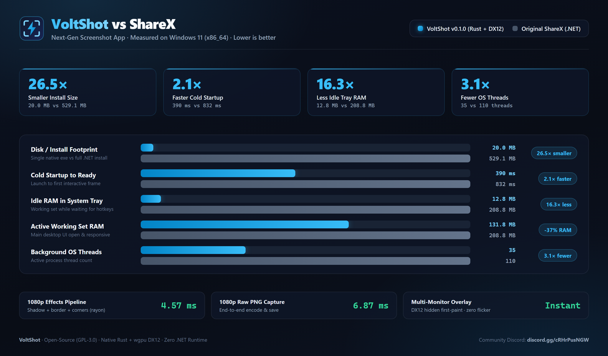

<div align="center">


# VoltShot

### The Next-Gen Screenshot & Capture App — Inspired by ShareX, Built in Rust + DirectX 12

[](LICENSE)
[](https://www.rust-lang.org/)
[](#download--install)
[](https://discord.gg/cRHrPusNGW)

[Download Installer](#download--install) · [Performance Benchmark](#voltshot-vs-sharex-benchmark) · [Features](#features) · [Join our Discord](https://discord.gg/cRHrPusNGW)

</div>

---

## Why I Built VoltShot

I've used ShareX for years, and honestly, its workflow is hard to beat — instant region capture, pixelate/blur on the fly, OCR, custom uploaders, screen recording, and zero paywalls.

But every time I looked at my system tray or waited for the overlay to pop up, one thought kept coming back to me: **we can have a much faster, lighter screenshot app.** Taking a quick screenshot shouldn't require half a gigabyte of runtime files on disk or 200 MB of idle RAM sitting in the background all day.

So I started building **VoltShot** from scratch in Rust with native DirectX 12 rendering.

**Here's the bigger vision:** I don't want VoltShot to stop at being *"just ShareX rewritten in Rust."* ShareX is the foundation we love and respect, and we want VoltShot to evolve into a true **next-gen screenshot & capture app** — insanely snappy, ultra-clean UI, multi-monitor flicker-free, packed with thoughtful quality-of-life features, and shaped directly by the people who use it every day.

If you've ever wished screenshot tools were faster, cleaner, or had that one killer feature nobody built yet — **come hang out and build this with us on [Discord](https://discord.gg/cRHrPusNGW)!**

---

## VoltShot vs ShareX Benchmark

Measured side-by-side on Windows 11 (`x86_64`) comparing **VoltShot v0.1.0 (Native Rust + DirectX 12)** against **Original ShareX (.NET)**:

<div align="center">
  
</div>

| Metric | Original ShareX (.NET) | VoltShot (Rust + DX12) | Difference |
| --- | ---: | ---: | --- |
| **Disk / Install Footprint** | 529.1 MB | **20.0 MB** (single binary) | **26.5× smaller** |
| **Cold Startup to Ready** | 832 ms | **390 ms** | **2.1× faster** |
| **Idle RAM in System Tray** | 208.8 MB | **12.8 MB** (working set) | **16.3× less idle RAM** |
| **Active RAM (Working Set)** | 208.8 MB | **131.8 MB** | **37% less active RAM** |
| **OS Threads** | 110 threads | **35 threads** | **3.1× fewer threads** |
| **1080p Effects Pipeline** *(shadow + border + rounded corners)* | — | **4.57 ms** *(rayon-parallel)* | Instant preview & export |
| **1080p Raw PNG Export** | — | **6.87 ms** | Sub-frame capture pipeline |

> *Single self-contained executable with zero `.NET` runtime overhead, native DirectX 12 rendering, automatic working-set trimming when minimized to tray, and zero multi-monitor flicker when opening region capture.*

---

## Download & Install

### Windows Installer *(Recommended)*

1. Download **`VoltShot-Setup-v0.1.0-windows-x86_64.exe`** from the [Releases](../../releases) page.
2. Run it — **no administrator prompt required** (installs cleanly into `%LOCALAPPDATA%\Programs\VoltShot`).
3. VoltShot is automatically registered as a proper Windows application:
   - **Windows Search & Start Menu** — press `Win` and type `VoltShot` anytime.
   - **Windows Settings → Apps → Installed apps** — clean one-click uninstall whenever you want.
   - **Optional Startup with Windows** — starts silently in your system tray (`Settings → Apps → Startup`).
   - **Run command** — press `Win + R` and type `VoltShot`.

### Portable Build

Prefer zero installation? Download **`VoltShot-v0.1.0-windows-x86_64-portable.zip`**, unzip `VoltShot.exe` anywhere, and run with `--portable` to keep settings and captures right beside the executable.

---

## Features

- **Instant, Flicker-Free Multi-Monitor Capture**: Native DX12 GPU overlay with hidden first-paint compositing, DWM transition disable, instant window snapping (skips hidden/cloaked windows), 11×11 GPU pixel magnifier loupe, and mouse-wheel scroll resizing for loupe zoom, Pixelate/Blur strength, stroke width, and font size.
- **On-Overlay Quick Annotations**: Draw arrows, rectangles, highlights, text, pixelate, and blur directly while selecting a region — hover any shape and press `Backspace`/`Delete` to remove it instantly.
- **Native Windows Drag-and-Drop**: Drag captures directly out of the gallery into Discord, Chrome, Slack, Figma, or Explorer via native Win32 Shell `DoDragDrop`.
- **Pro Image Editor**: 18 tools including `SpeechBalloon`, redaction-safe `Magnifier`, `Spotlight`, `SmartEraser`, PNG sticker stamps, corner resize handles, undoable canvas resize, and `.sxed` project files.
- **4.6 ms Rayon-Parallel Image Effects**: 13 pure-Rust filters (`DropShadow`, `Border`, `RoundedCorners`, `AutoCrop`, `WatermarkText`, `ImageWatermark`, `Resize`, `CanvasPadding`, `Colorize`, `Slice`, and more) with live preview and TOML preset import/export.
- **Native Windows OCR & Power Tools**: Built-in **Windows WinRT OCR** (zero install, automatic Tesseract CLI fallback), QR code generator & decoder, screen color picker (`HEX`/`RGB`/`HSL`/`CMYK`), pixel ruler, file hash checker, directory indexer, image combiner + Contact Sheet grid, and Pin-to-Screen floating windows.
- **Hardware-Accelerated Screen Recording**: MP4 (`NVENC` / `QSV` / `AMF` / `libx264`), WebM (`VP9`), and low-RAM two-pass palette GIF with optional audio capture and an always-on-top Recording HUD.
- **Cloud Uploaders & Automation**: Full ShareX `.sxcu` custom uploader compatibility, native **AWS S3 / Cloudflare R2 / Backblaze B2 / MinIO (SigV4)**, Imgur, Discord Webhooks, GitHub Gist, Pastebin, URL shorteners (`is.gd`, `TinyURL`, `.sxcu`), per-hotkey Workflows, SQLite `#tag` history search, and Watch Folders.
- **26 Languages Built-In**: Instant UI localization across 26 languages with lazy Unicode font loading so unused scripts cost zero RAM.

### Default Global Hotkeys

| Shortcut | Action |
| --- | --- |
| `Ctrl + PrintScreen` | Multi-monitor region capture |
| `PrintScreen` | Fullscreen capture |
| `Alt + PrintScreen` | Active window capture |
| `Shift + PrintScreen` | Repeat last region |
| `Ctrl + Shift + O` | Capture text region (OCR → clipboard) |
| `Ctrl + Shift + C` | Screen color picker (HEX → clipboard) |
| `Ctrl + Shift + E` | Open image editor |
| `Ctrl + Shift + PrintScreen` | Toggle MP4 screen recording |
| `Alt + Shift + PrintScreen` | Toggle GIF recording |

---

## Join the Community — Help Build What's Next!

VoltShot is just getting started, and we want it to become the **go-to next-gen screenshot app** built in the open with real power users, developers, designers, and gamers.

Got ideas for cool new features beyond ShareX? Want to test bleeding-edge builds, help polish the UI, write Rust PRs, or just tell us what annoys you about existing capture tools?

<div align="center">

### 👉 [Join the VoltShot Discord Community](https://discord.gg/cRHrPusNGW)

</div>

---

## Building from Source

Requires Rust `1.85+` via `rustup`. On Linux, see [CONTRIBUTING.md](CONTRIBUTING.md) for system packages.

```bash
# Run the full test suite
cargo test --workspace

# Build VoltShot (release)
cargo build --release -p voltshot-app

# Build the self-contained Windows Installer (embeds compressed VoltShot.exe)
VOLTSHOT_EMBED_PAYLOAD=1 cargo build --release -p voltshot-installer

# Run the 1080p effects pipeline benchmark
cargo run --release -p voltshot-effects --example bench_pipeline
```

## License

VoltShot is free and open-source software licensed under [`GPL-3.0-or-later`](LICENSE), continuing the open-source spirit of upstream [ShareX](https://github.com/ShareX/ShareX).
