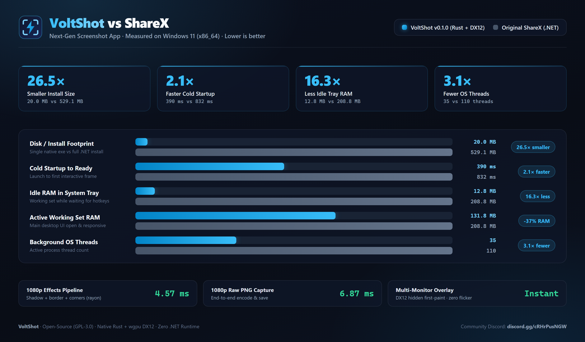

  

# ⚡ VoltShot v0.1.0 — First Public Release

> **A next-gen screenshot & capture app — inspired by ShareX, rebuilt from scratch in Rust + DirectX 12.**

## Why I Built This

I've used ShareX for years and love how capable it is, but I kept wondering: *why can't we have a screenshot tool that feels genuinely instant and barely touches RAM or disk?*

So I started building **VoltShot** from the ground up in Rust with native DirectX 12 rendering — not just to make a 1:1 "ShareX in Rust", but to lay down a rock-solid, blazing-fast foundation for a **next-gen screenshot app** with modern UX and cool new features we'll build together with the community.

---

## ⚡ VoltShot vs Original ShareX (Measured on Windows 11)

| Metric | Original ShareX (.NET) | VoltShot v0.1.0 (Rust + DX12) | Improvement |
| --- | ---: | ---: | --- |
| **Disk Footprint** | 529.1 MB | **20.0 MB** (1 executable) | **26.5× smaller** |
| **Cold Startup** | 832 ms | **390 ms** | **2.1× faster** |
| **Idle Tray RAM** | 208.8 MB | **12.8 MB** (working set) | **16.3× less idle RAM** |
| **Active RAM** | 208.8 MB | **131.8 MB** | **37% less RAM** |
| **OS Threads** | 110 | **35** | **3.1× fewer threads** |
| **1080p Image Effects** | — | **4.57 ms** *(rayon-parallel)* | Instant |

---

## 📦 Which File Should I Download?

- **`VoltShot-Setup-v0.1.0-windows-x86_64.exe`** *(Recommended)* — Lightweight native Windows installer (~8 MB download, **no admin prompt required**). Installs VoltShot cleanly as a proper Windows app so you can find it in **Windows Search / Start Menu**, manage it in **Settings → Apps → Installed apps**, optionally launch at startup in the system tray, and uninstall cleanly anytime.
- **`VoltShot-v0.1.0-windows-x86_64-portable.zip`** — Single self-contained `VoltShot.exe`. Unzip anywhere and run (pass `--portable` to store config alongside the exe).

---

## ✨ Highlights in v0.1.0

- **Zero-Flicker Multi-Monitor Capture**: Native DX12 GPU overlay with hidden first-paint compositing, DWM transition lock, instant window snapping, GPU pixel magnifier loupe, and mouse-wheel scroll resizing for loupe zoom, Pixelate/Blur strength, stroke width, and text size.
- **Drag-and-Drop Straight Out of Gallery**: Native Win32 Shell `DoDragDrop` lets you drag screenshots directly into Discord, browsers, Slack, or Explorer.
- **Pro Screenshot Editor & 4.6 ms Effects Engine**: 18 editor tools (including `SpeechBalloon`, redaction-safe `Magnifier`, `Spotlight`, `SmartEraser`, PNG stamps) + 13 rayon-parallel image effects.
- **Native Windows OCR, Recording & Uploaders**: Zero-install Windows WinRT OCR (`Ctrl+Shift+O`), screen color picker (`Ctrl+Shift+C`), NVENC/QSV/AMF MP4 & low-RAM GIF recording, full `.sxcu` + AWS S3/R2/MinIO SigV4 uploaders, and SQLite `#tag` history search.
- **26 UI Languages Built-In** with lazy Unicode font loading and sleek Obsidian/Porcelain themes.

---

## 💬 Join the Community!

We're just getting started and want **VoltShot** to grow way beyond a ShareX port into the next-gen capture tool everyone wishes existed.

Want to suggest features, test builds, contribute Rust/UI code, or hang out with fellow power users?

👉 **Join our Discord:** https://discord.gg/cRHrPusNGW
